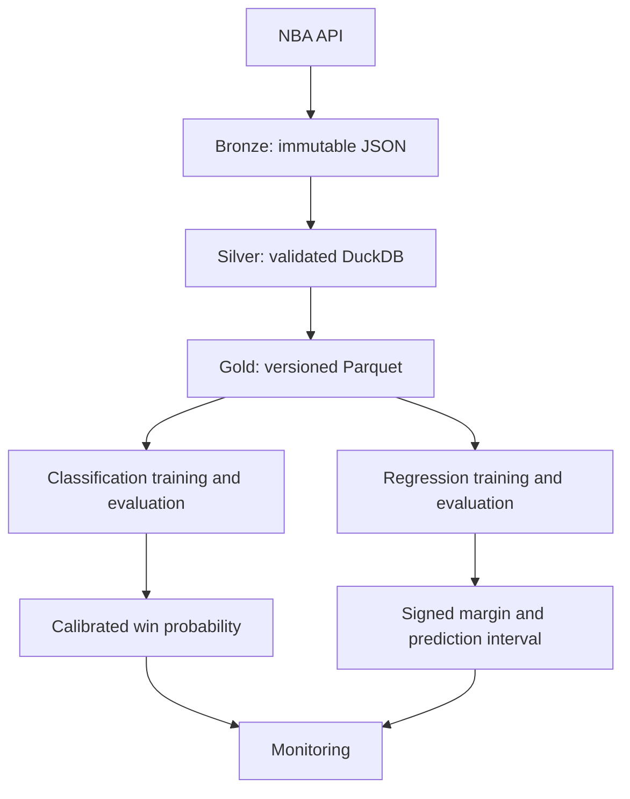

# Architecture

## Status and scope

Version 0.1.0 establishes the package boundaries, configuration, logging, tests,
and documentation. The layer and ML designs below are contracts for future work,
not claims of implemented functionality. The platform is a single Python repository
and deployable unit; layers are ordinary Python modules, not services.

## Logical data flow



| Boundary | Responsibility | Planned storage |
| --- | --- | --- |
| `bronze` | Fetch and preserve raw responses and provenance | JSON |
| `silver` | Normalize, validate, deduplicate, reconcile | DuckDB |
| `gold` | Build point-in-time features, labels and dataset manifests | Parquet |
| `ml` | Train, evaluate, predict and monitor two independent objectives | Model and evaluation artifacts |

Downstream layers read the preceding validated boundary. Gold may expose training
labels separately from prediction features. ML must never access raw API responses
directly. Orchestration belongs in explicit entry points added when needed, not in
module imports. Shared configuration and logging live at the package root. Avoid
circular imports and unneeded abstraction. No network or data work at import time.

## Planned physical layout

```text
data/                         # ignored by Git
  bronze/                     # immutable response snapshots and provenance
  silver/nba.duckdb           # validated local relational store
  gold/                       # versioned datasets and manifests
artifacts/                    # ignored by Git
  classification/             # separately versioned models and reports
  regression/                 # separately versioned models and reports
```

The directories and database are not created in this phase. Paths are configurable.
Use `pathlib`, explicit encodings (UTF-8), and UTC timestamps for stored event and
provenance times; preserve original source date fields. Never hardcode local paths.

## Bronze: raw source of record

Future ingestion will store the complete response body without normalization or
in-place modification. Record endpoint, request parameters (excluding secrets),
retrieval timestamp, source status, checksum and snapshot identity in metadata or a
sidecar. Keep every distinct retrieval immutable; define idempotent retry behavior
and safe atomic publication. A correction creates a new snapshot. Do not silently
substitute malformed or unsuccessful responses for successful data.

## Silver: canonical relational data

DuckDB is the planned embedded relational store. Start with game, team and team-game
relations; define exact schemas and keys in the Silver phase. A game identifier must
remain a string, preserving leading zeros. Use explicit types and validation, not
implicit inference as the source of truth. Retain source provenance, distinguish
scheduled/postponed/canceled games from completed games, and make transformations
replayable and transactional. A missing outcome is not a loss, and a zero-minute
unplayed record is not a completed game. Do not fabricate labels or replace missing
stats with zero. Reject or quarantine invalid records with actionable diagnostics.

## Gold: features and dataset versioning

Use one row per game and prediction cutoff. Define the prediction horizon before
feature engineering; the initial proposed horizon is pregame, with exact cutoff
policy to be decided before Gold implementation. Each feature must use only data
available by that cutoff, including realistic availability of corrected source data.
Do not use current-game box scores or season aggregates that contain future games.
Rolling statistics must exclude the target game and later games. Maintain separate
labels, schema versions, feature definitions, source references, cutoff policy,
row counts, split dates and content hashes in immutable dataset manifests.
Partition only when justified by actual data size and access patterns.

## Machine learning objectives

- Classification: label 1 for a completed home win and 0 for a completed home loss.
  Output a probability in [0, 1]. Train and calibrate on chronological disjoint
  data or an explicitly leakage-safe temporal validation scheme. Evaluate on a
  separate later holdout with log loss, Brier score, reliability diagrams and
  accuracy as a secondary measure. Compare against a historical home-win baseline.
- Regression: label is final home points minus final away points, including overtime.
  Output signed margin and a lower/upper prediction interval for the game outcome,
  not a confidence interval for the mean. Choose the interval method and nominal
  coverage during implementation. Measure MAE, RMSE, empirical interval coverage
  and interval width on held-out chronological games. Compare against a simple
  historical margin baseline.

Both objectives may share validated features and split policy, but must have separate
training, evaluation, calibration/interval estimation, artifacts and version identifiers.
Do not derive win probability from margin as the primary classifier or force the two
predictions to agree. Fit preprocessing on training data only. Use rolling-origin
backtests, with tuning and calibration confined to appropriate earlier folds. Preserve
an untouched final test period; never choose models by repeatedly inspecting it.

Future predictions must record game identity, prediction cutoff, model and dataset
versions, outputs and creation time. Monitoring will track data quality, feature drift,
probability calibration, error, interval coverage and outcome availability. Thresholds,
retraining triggers, and operational schedules will be defined from evidence, not
invented in this phase. Do not claim forecasting performance without backtesting.

## Engineering decisions

- Python 3.11+; recommend 3.12. Standard-library configuration and logging.
- setuptools and pip; one `pyproject.toml`. Dependency ranges are not a lock.
- pytest and Ruff; CI matrix for Windows and Linux. No runtime dependency until needed.
- Version code with SemVer; independently version data and model artifacts.
- Prefer functions and simple modules; introduce interfaces only for real variation.
- No microservices, cloud infrastructure, dashboard, orchestration framework or API
  server until requirements justify them.
